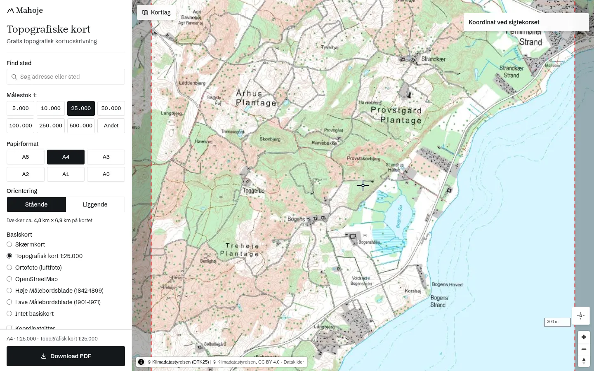
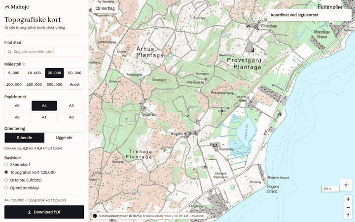
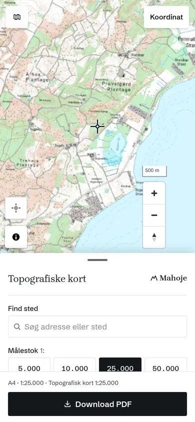
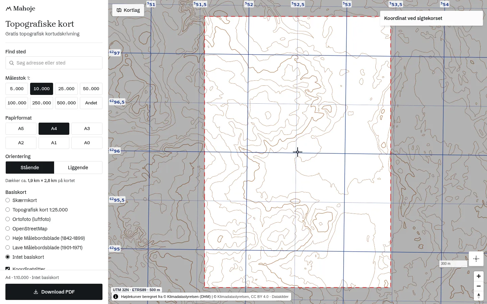
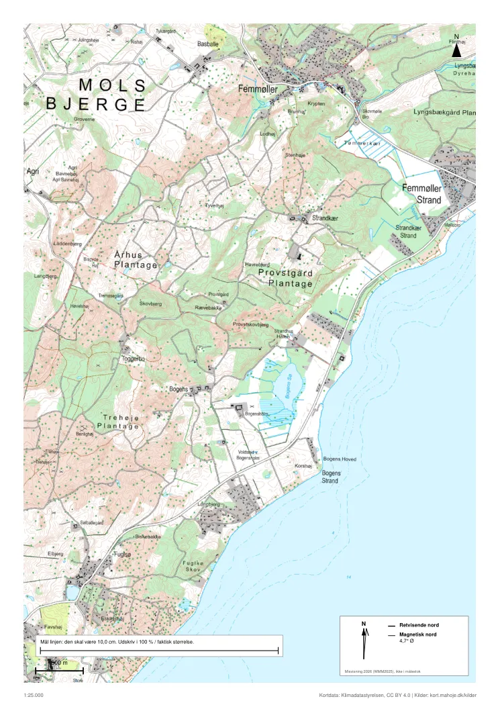

# Kort: print-ready topographic maps of Denmark

Free, print-ready topographic maps of Denmark as PDF. Pick a scale, paper size
and grid, and download. No login, no cookies.

**Live:** [kort.mahoje.dk](https://kort.mahoje.dk) · also runs as
[kort.solaris.dk](https://kort.solaris.dk) for the scout group Solaris

[](https://github.com/mahope/kort/actions/workflows/ci.yml)
[](LICENSE)



## Who it is for

- **Scouts and scout leaders** who need a proper paper map for a hike, a night
  game or for teaching kids to read a map.
- **Orienteering** clubs and trainers: a white map with 5 m contours and a UTM
  grid in a few clicks.
- **Hikers, paddlers and sailors** who want a map in their pocket that never
  runs out of battery.

I'm a scout myself and kept missing a simple, free way to print a decent
topographic map of Denmark, so I built one. It is free and will stay free.

The interface is in Danish.

## Screenshots

| Choose scale and paper size | Mobile |
|---|---|
|  |  |

| Orienteering style: no base map, 5 m contours, UTM grid | The PDF (A4, 1:25,000) |
|---|---|
|  |  |

Example PDF: [example-a4-1-25000.pdf](https://github.com/mahope/kort/releases/download/v0.1.0/example-a4-1-25000.pdf)
(A4, 1:25,000, Mols Bjerge).

## Features

- **Map layers:** Skærmkort in four styles, the 1:25,000 topographic map (DTK25),
  orthophoto, OpenStreetMap, two series of historic maps (1842-1971) or no base map at all.
- **Overlays:** contours (0.5 m to 10 m, with height labels), hillshade, cadastre,
  place names, sea depths and seabed relief, sea marks, lake depth contours,
  wrecks and historic lake charts (marked *not for navigation*).
- **Scales** 1:5,000 to 1:500,000, or any custom scale from 1:1,000 to 1:1,000,000.
- **Paper sizes** A5 to A2 in portrait or landscape, plus A1 and A0 as one sheet for a print shop.
- **Multi-page prints and floor maps:** up to 5 × 5 sheets with overlap, an
  overview page, corner marks and sheet labels.
- **Coordinate grids:** UTM, MGRS and DKTM1-4 on screen and in the PDF, plus a
  readout of the coordinate under the crosshair.
- **Magnetic declination** (WMM2025) on screen and as a diagram in the PDF.
- **Norway and Sweden:** the map switches to Kartverket and OpenTopoMap when you
  pan across the border.
- **Import and draw:** GPX, GeoJSON and KML files; draw routes and measure distances.
- **Search** addresses and place names (Danish and Norwegian).
- **Share** a map view as a URL; bookmarks and print history in the browser.
- **PWA:** installable, works offline with cached tiles, and can save an area for offline use.
- **No account, no cookies.** Anonymous, cookieless visitor counts via self-hosted Plausible, only on the two production domains.
- Light and dark theme, desktop sidebar and mobile bottom sheet.

## Tech stack

| | |
|---|---|
| Framework | [Next.js 16](https://nextjs.org/) (App Router, Turbopack), [React 19](https://react.dev/), TypeScript |
| Map | [MapLibre GL JS 6](https://maplibre.org/) via [react-map-gl](https://visgl.github.io/react-map-gl/), [PMTiles](https://github.com/protomaps/PMTiles) for our own contour tiles |
| PDF | [jsPDF](https://github.com/parallax/jsPDF), rendered in the browser |
| State | [Zustand](https://zustand.docs.pmnd.rs/) with localStorage persistence |
| Styling | [Tailwind CSS 4](https://tailwindcss.com/) (CSS-first config) |
| Drawing | [Terra Draw](https://github.com/JamesLMilner/terra-draw) |
| Tests | [Vitest](https://vitest.dev/), ESLint, oxlint, TypeScript 7 for fast type checks |
| Hosting | Docker (Node 22, Next.js standalone) on [Dokploy](https://dokploy.com/) |

## Run locally

Requires Node.js 22 and npm.

```bash
git clone https://github.com/mahope/kort.git
cd kort
cp .env.example .env.local   # optional, every variable has a default
npm ci --ignore-scripts
npm run dev                  # http://localhost:3000
```

Checks (the same as CI):

```bash
npm run lint        # ESLint (authoritative); npm run lint:fast runs oxlint
npm run typecheck   # TypeScript 7 (native tsc); Next and ESLint still use TypeScript 6
npx vitest run      # unit tests
npm run build       # production build
```

Unused code is checked with `npx knip@6.44.1`; `knip.json` lists the known
false positives.

## Environment variables

All are optional and public (`NEXT_PUBLIC_*` values are baked into the client
bundle at build time). See [.env.example](.env.example) and [docs/tokens.md](docs/tokens.md).

| Variable | Default | Purpose |
|---|---|---|
| `NEXT_PUBLIC_BRAND` | `mahoje` | `mahoje` (kort.mahoje.dk) or `solaris` (kort.solaris.dk): name, logo, colours, domain |
| `NEXT_PUBLIC_DATAFORSYNINGEN_TOKEN` | fallback in `src/lib/map/styles.ts` | Map tiles and WMS from Dataforsyningen. Get your own free token at [dataforsyningen.dk](https://dataforsyningen.dk/) if you deploy a copy |
| `NEXT_PUBLIC_ADRESSEVAELGER_TOKEN` | fallback in `src/lib/api/address.ts` | Address search (Adressevælger) |
| `NEXT_PUBLIC_CONTOURS_URL` | `https://tiles.mahoje.dk/kurver-5m.pmtiles` | PMTiles file for the 5 m / 10 m contours |

Never give a secret a `NEXT_PUBLIC_` name. A service that needs a private key
must be called through a server-side route.

## Deploy

```bash
docker build -t kort \
  --build-arg NEXT_PUBLIC_BRAND=mahoje \
  --build-arg NEXT_PUBLIC_DATAFORSYNINGEN_TOKEN=your_token .
docker run -p 3000:3000 kort
```

Or `docker compose up` with the variables in your environment. Tokens are
build arguments: changing them needs a new build, not just a restart.

Production runs on Dokploy. Both kort.mahoje.dk and kort.solaris.dk build the
`Dockerfile` from `main` and deploy automatically on every merge. CI
(`.github/workflows/ci.yml`) runs build, lint, typecheck, tests, a non-blocking dependency
audit and a gitleaks secret scan on every pull request; it does not deploy.

## Architecture

```
src/
├── app/            Next.js routes: / (map), /om, /kilder, /topografisk-kort-print, /api/stednavne
├── components/     map/, sidebar/, search/, print/, ui/, about/
├── lib/
│   ├── map/        map styles, sources and credits, our own vector overlays
│   ├── pdf/        PDF layout, off-screen renderer, generator, multi-page assembly
│   ├── geo/        UTM/MGRS/DKTM, declination (WMM2025), regions, print-area maths
│   ├── api/        search clients (Adressevælger, /api/stednavne, Kartverket)
│   ├── stednavne/  place-name index, search and rate limit
│   ├── import/     GPX, GeoJSON and KML import
│   ├── offline/    offline areas and tile cache (with public/sw.js)
│   └── url/        shareable URL state
├── stores/         Zustand stores (map, print, ui, import, draw, history, bookmarks, offline)
├── constants/      scales, paper formats, data sources (shown on /kilder)
└── config/         brand config (mahoje / solaris)
```

- **Map:** Dataforsyningen's vector tiles and WMS in Web Mercator (EPSG:3857)
  are rendered directly by MapLibre; no reprojection.
- **PDF:** the browser creates a hidden MapLibre instance at the target
  resolution (up to 300 dpi), waits for every tile, and adds the image to jsPDF
  with grid, scale bar, north arrow, declination diagram and credits. The scale
  bar and print calibration line have matching white boxes for legibility.
  On sheets with a neighbour below, both boxes sit above the overlap strip.
  Nothing is rendered on the server.
- **Search:** addresses come from Adressevælger. Place names are searched in our
  own `/api/stednavne` over a snapshot of Danske Stednavne
  (`data/stednavne.tsv.gz`), because DAWA closed in October 2026 and no live
  replacement offers free-text place-name search.
- **Own data:** sea depths, wrecks and the lake chart index are small GeoJSON
  files in `public/data/soekort/`; the 5 m and 10 m contours are PMTiles derived
  from the Danish elevation model and served from `tiles.mahoje.dk`.

More detail: [Norway and Sweden](docs/nordic.md) ·
[grids and declination](docs/grids-and-declination.md) ·
[security headers and CSP](docs/security.md) ·
[public tokens](docs/tokens.md) ·
[dependency policy](docs/dependency-security.md) ·
[maintenance](docs/maintenance.md) ·
[offline tests](docs/offline-tests.md)

## Roadmap

Open ideas and known bugs live in [GitHub issues](https://github.com/mahope/kort/issues).
Bigger themes right now: our own map tiles behind a CDN instead of live WMS
([#39](https://github.com/mahope/kort/issues/39)), more offline areas before
a trip ([#36](https://github.com/mahope/kort/issues/36)) and moving map layers
to Datafordeleren as Dataforsyningen closes services ([#5](https://github.com/mahope/kort/issues/5)).

Contributions are welcome. Read [CONTRIBUTING.md](CONTRIBUTING.md) first. Release notes are in [CHANGELOG.md](CHANGELOG.md).

## License and data attribution

The code is released under the [MIT License](LICENSE), © 2026 Mads Holst Jensen / Mahope.

The map data is **not** covered by the MIT License. Danish map data comes from
[Klimadatastyrelsen](https://www.klimadatastyrelsen.dk/) via
[Dataforsyningen](https://dataforsyningen.dk/) under CC BY 4.0, which requires
credit. The app shows it on the map, in the PDF footer and on the
[/kilder](https://kort.mahoje.dk/kilder) page, and so must your copy. Outside
Denmark: © [Kartverket](https://www.kartverket.no/) (CC BY 4.0) and ©
[OpenTopoMap](https://opentopomap.org/) (CC-BY-SA) with data from ©
OpenStreetMap contributors and elevation data from SRTM and
[Sonny](https://sonny.4lima.de/).

Every data source, font and library with its licence is listed in
[NOTICE.md](NOTICE.md). Fonts (Brygada 1918, Schibsted Grotesk) are under the
SIL Open Font License.

## Made by

Kort is built by **Mads Holst Jensen**, a freelance web developer from Odense,
Denmark. Day to day I help businesses with WordPress, WooCommerce, SEO and
performance at [mahoje.dk](https://mahoje.dk).
