# Vis og print kort over Norge og Sverige

Flyt kortet til Norge eller Sverige, så skifter det selv kilde. I Norge viser det Kartverkets topografiske kort, og i Sverige og langs grænsen OpenTopoMap. Gitter, misvisning, PDF, flere ark og "Intet basiskort" virker som i Danmark. Norske stednavne kan søges. Danmark er uændret.

Skærmbillederne er taget med `scripts/capture-nordic.mjs` mod `next start`. PDF-billederne er kortbilledet fra den downloadede PDF (300 dpi i 1:25.000, 200 dpi i 1:50.000), nedskaleret og som 100 %-udsnit.

| Sted | Kortvisning | PDF | PDF 100 % | Kilder i PDF'en |
| --- | --- | --- | --- | --- |
| Jotunheimen, 1:25.000 | 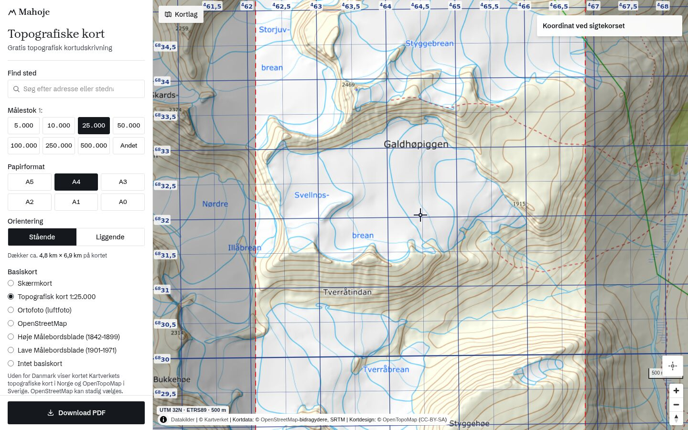 | 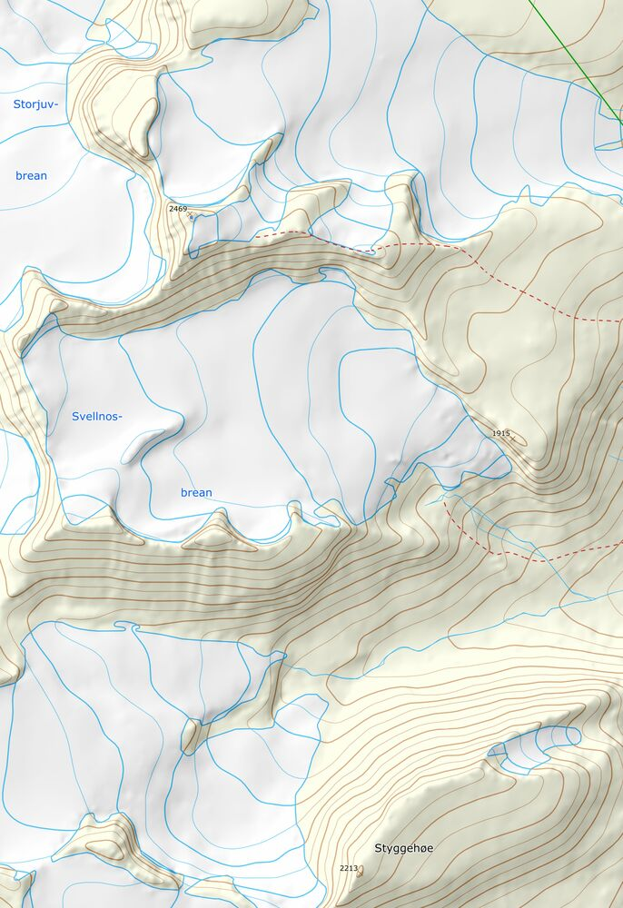 | 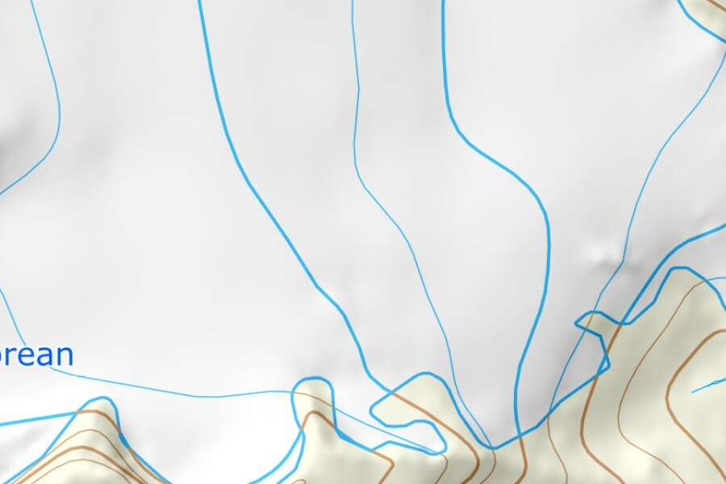 | 117 kald til Kartverket WMS, 0 til OpenTopoMap |
| Jotunheimen, kun højdekurver | 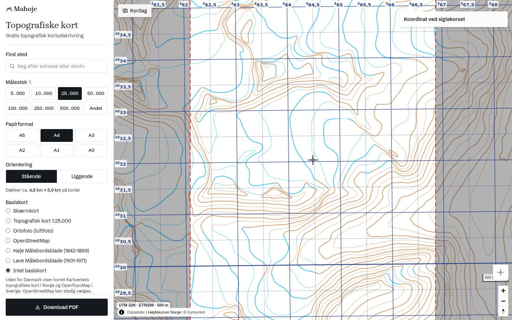 | 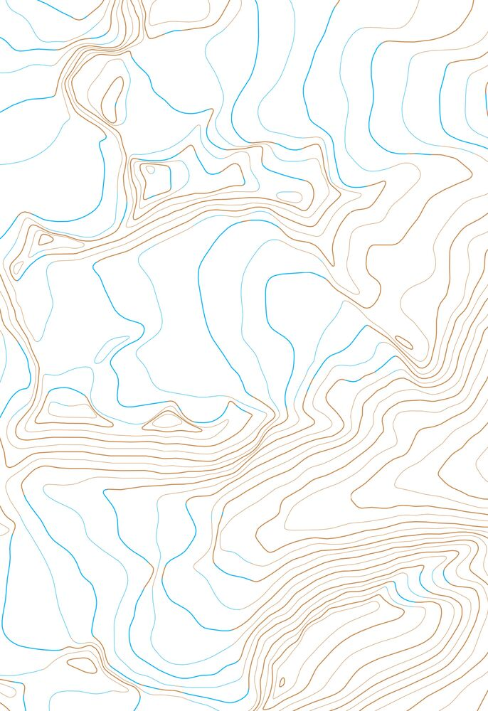 | | Kartverket WMS (højdekurver) |
| Kebnekaise, 1:50.000 | 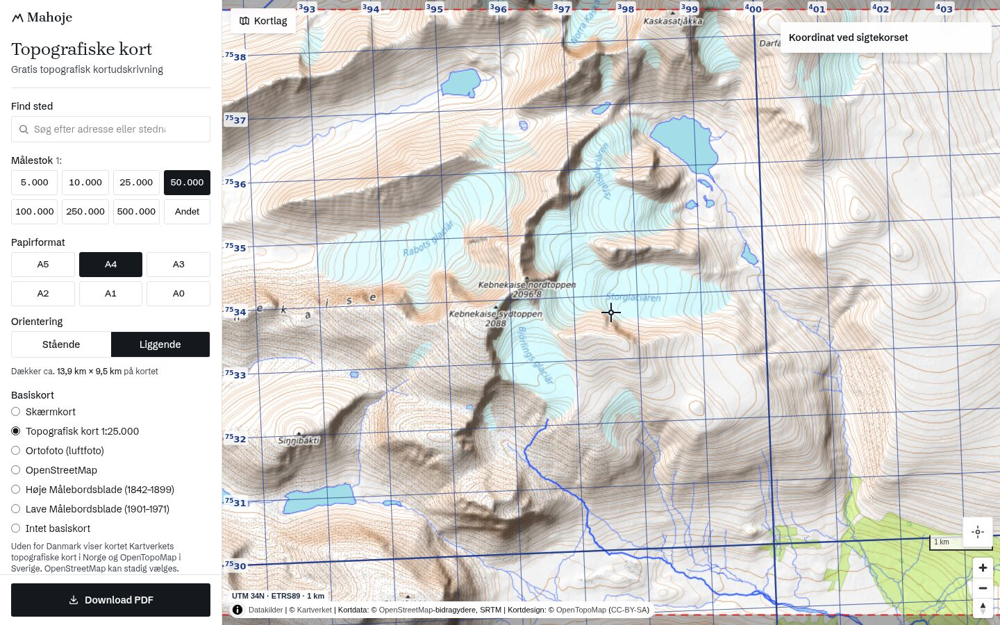 | 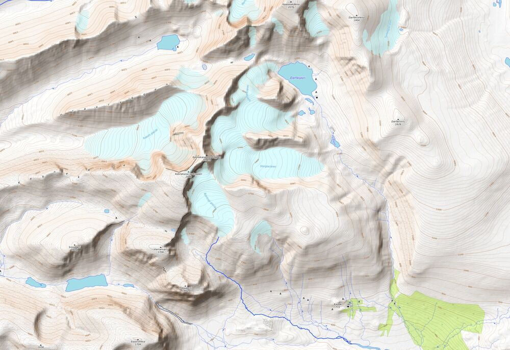 | 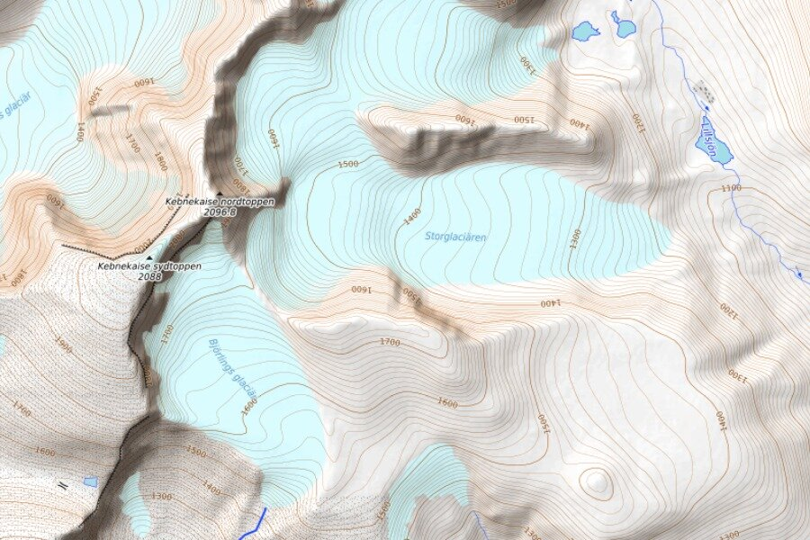 | 63 kald til OpenTopoMap, 0 til Kartverket |
| Dalsland, 1:25.000 | 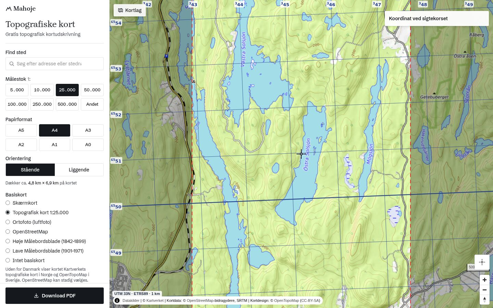 | 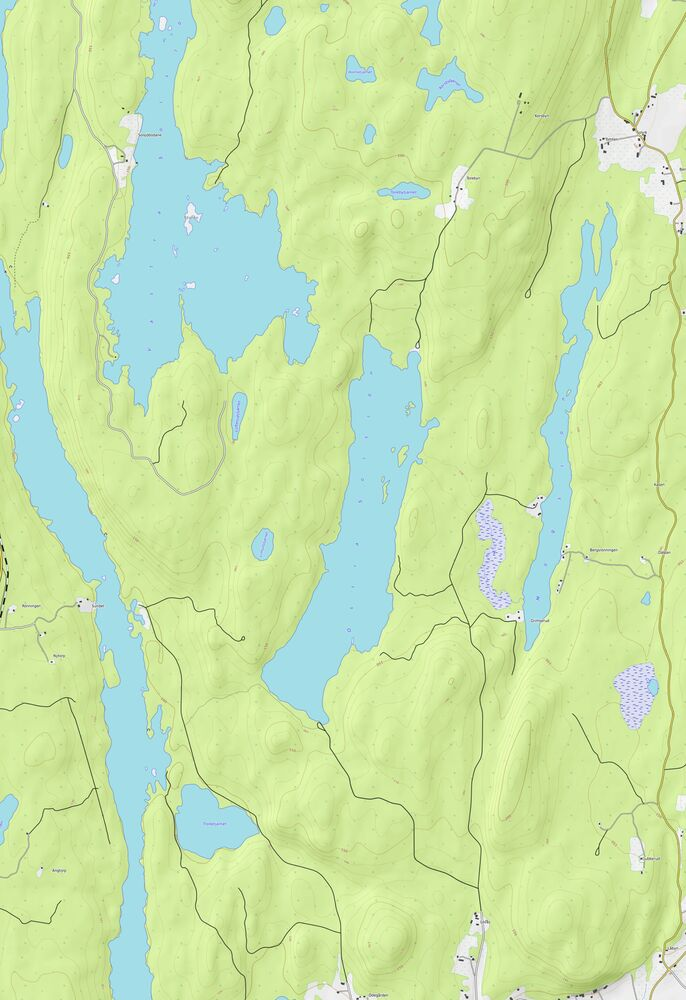 | 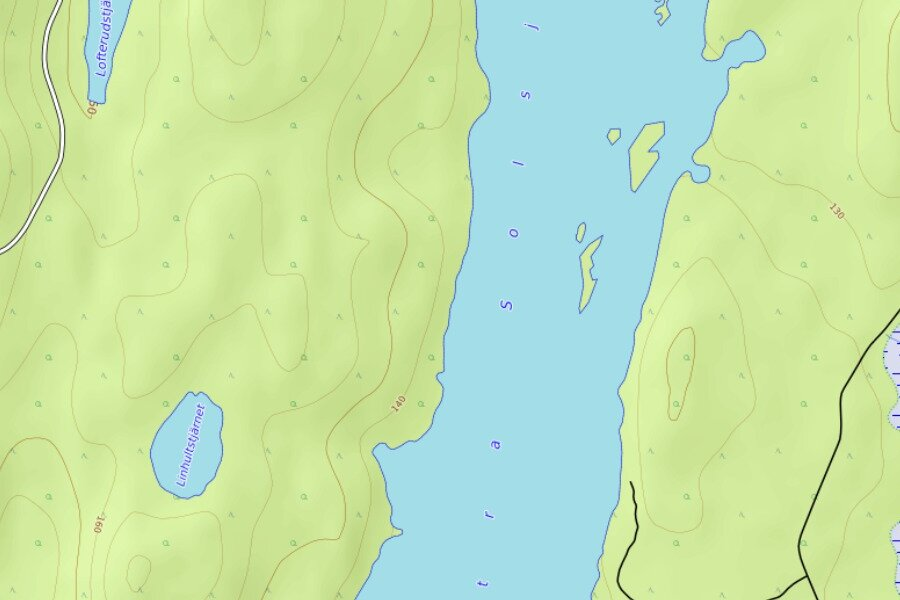 | 108 kald til OpenTopoMap, 0 til Kartverket |
| Svinesund (grænsen), 1:50.000 | 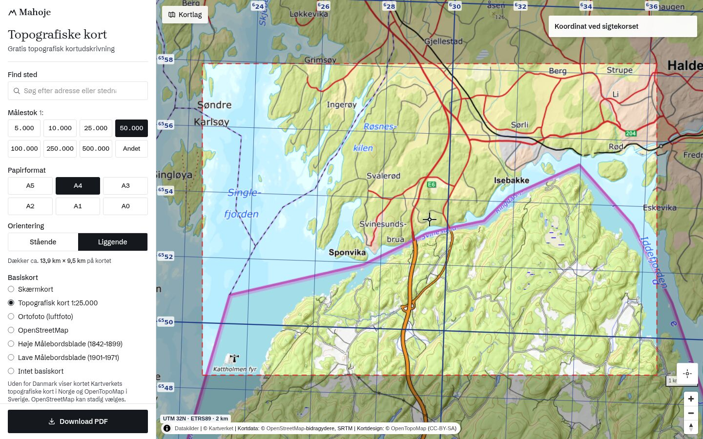 | 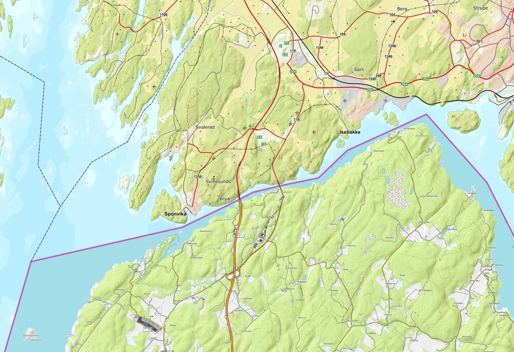 | | begge |

PDF-fødderne (tekst trukket ud af PDF'erne):

- Jotunheimen: `1:25.000 | UTM 32N / ETRS89 | Gitter 1 km` og `Kortdata: Kartverket | Kilder: kort.mahoje.dk/kilder`
- Kebnekaise: `1:50.000 | UTM 34N / ETRS89 | Gitter 1 km` og `Kortdata: OpenTopoMap/OpenStreetMap | Kilder: kort.mahoje.dk/kilder`
- Dalsland: `1:25.000 | UTM 33N / ETRS89 (= SWEREF 99 TM) | Gitter 1 km`
- Danmark (kontrol, Himmelbjerget): uændret `Kortdata: Klimadatastyrelsen, CC BY 4.0`, kun kald til api.dataforsyningen.dk
